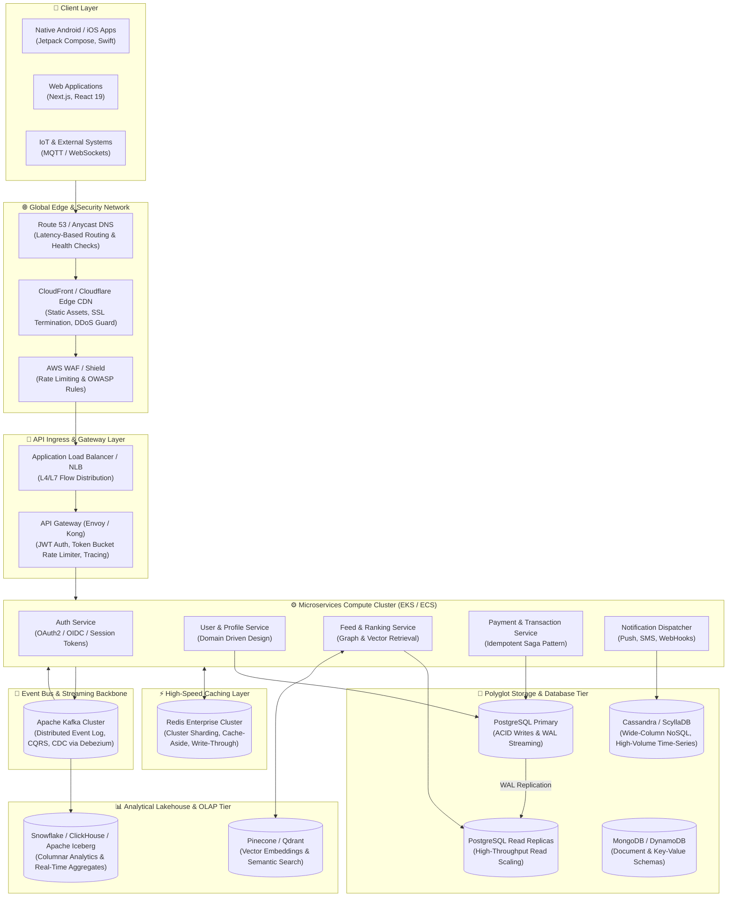
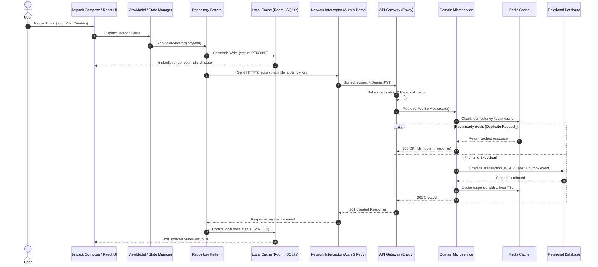
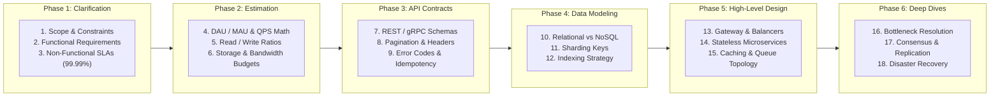

# 🏛️ Computer Science & System Design Knowledge Vault

> **A Comprehensive 152-Module Engineering Knowledge Base** covering Hardware Architecture, Java DSA, Relational & Distributed Databases, Backend Engineering, Frontend Deep Dives, Fullstack Integration, Android Development, Large-Scale System Design (HLD & LLD), AWS Cloud, Docker & Kubernetes, Python, Machine Learning / LLMs / RAG, and Forward-Deployed Engineering.

[]()
[]()
[]()
[]()
[]()
[]()

---

## 🏛️ System Design & Distributed Architecture Diagrams

### 1. Hyperscale Distributed System Topology (HLD)

This diagram illustrates the canonical end-to-end architecture for high-concurrency distributed systems covered throughout Section H and Section C:



---

### 2. End-to-End Layered Execution Lifecycle (LLD & Microservices)

This sequence diagram maps the complete request lifecycle across client presentation, offline-first caching, network interceptors, gateway validation, and distributed data persistence:



---

### 3. The 55-Phase System Design Interview Execution Framework

A structured methodology for tackling complex Large-Scale System Design problems in top-tier engineering interviews:



---

## 🧭 Master Knowledge Map

```
cs-system-design-vault/
├── 00_MASTER_INDEX.md              # Complete tracking registry & concept index
├── A_Hardware_CS_Foundations/      # CPU architecture, Memory hierarchy, Cache lines, Virtual memory, OS, Networking
├── B_DSA_Java/                     # Big-O, Two pointers, Linked lists, Trees, Heaps, Graphs, DP (1D/2D), Greedy, Tries
├── C_DBMS_Databases/               # Relational theory, PostgreSQL MVCC/WAL, Indexing, MongoDB, Redis, Cassandra, Kafka
├── D_Backend_Development/          # REST/gRPC/GraphQL, Spring Boot, Node.js/Go, Auth/JWT/OAuth2, Security, Microservices
├── E_Frontend_Development/         # DOM, JS Event loop, React 19 internals, State management, Web performance, Webpack/Vite
├── F_FullStack_Integration/        # API integration, WebSocket, Caching strategies, End-to-end testing, Monorepo setups
├── G_Android_Development/          # Android runtime (ART), Jetpack Compose, Coroutines/Flow, Clean Architecture, Dependency Injection
├── H_System_Design/                # HLD & LLD, Instagram, WhatsApp, URL Shortener, Distributed systems, 55-Phase Interview Mastery
├── I_AWS_Cloud/                    # AWS Well-Architected, IAM, VPC, EC2, ECS/EKS, Lambda, S3, DynamoDB, CloudWatch
├── J_Docker_Kubernetes/            # Container runtimes, Dockerfiles, K8s Architecture, Pods, Deployments, Services, Helm
├── K_Python_Fundamentals/          # Python data model, GIL, Asyncio, Memory management, Decorators, Metaclasses
├── L_AI_ML_DeepLearning/           # Math foundations, Classical ML, PyTorch, CNNs/RNNs, Transformers, LLMs, RAG & Vector DBs
├── M_Data_Science_Analytics/       # Data pipelines, Pandas, Feature engineering, Statistical modeling, A/B Testing
└── N_GTM_FDE/                      # Forward-deployed engineering, Production debugging, Observability, Post-mortems
```

---

## 📊 Modules & Curriculum Overview

| # | Domain Section | Files | Core Highlights |
|:---|:---|:---|:---|
| **A** | **Hardware & CS Foundations** | 6 files | Clock cycles, ALU, cache lines, virtual memory paging, MMU/TLB, JVM stack/heap, TCP/UDP sockets |
| **B** | **DSA in Java** | 19 files | Contiguous memory, two pointers, sliding window, monotonic queues, BSTs, AVL/Red-Black, DP, Dijkstra, Tries |
| **C** | **DBMS & Storage Engines** | 10 files | 1NF–BCNF normalization, SQL CTEs/window functions, PostgreSQL MVCC & WAL, B-Tree/GIN/BRIN indexing |
| **D** | **Backend Engineering** | 16 files | Idempotency, rate limiters, Spring Boot, Go concurrency, OAuth2/OIDC, circuit breakers, CQRS, event sourcing |
| **E** | **Frontend Internals** | 14 files | Browser rendering pipeline, VDOM diffing, React Fiber, concurrent rendering, memory leaks, SSR/SSG/ISR |
| **F** | **Full-Stack Integration** | 7 files | SSE vs WebSockets, schema registries, distributed tracing, resilience engineering, fullstack telemetry |
| **G** | **Modern Android Architecture** | 16 files | ART vs Dalvik, lifecycle, Jetpack Compose recomposition, Coroutines, Flow, Hilt/Koin, Clean Architecture |
| **H** | **System Design at Hyperscale** | 10 files | Load balancers, consistent hashing, distributed caching, Instagram/WhatsApp designs, 55-Phase Interview Mastery |
| **I** | **AWS Cloud Infrastructure** | 10 files | Multi-AZ VPC topology, IAM least privilege, ECS Fargate vs EKS, DynamoDB single-table design, CloudFront |
| **J** | **Docker & Kubernetes** | 9 files | Namespaces & cgroups, multi-stage Docker builds, Pod lifecycle, K8s scheduler, Service mesh, Helm charts |
| **K** | **Python Engineering** | 5 files | CPython internals, memory management, GIL, asyncio event loop, generators, descriptors |
| **L** | **AI, Machine Learning & LLMs** | 18 files | Linear algebra, backpropagation, PyTorch tensors, self-attention, Transformers, LoRA fine-tuning, RAG pipelines |
| **M** | **Data Science & Analytics** | 6 files | Exploratory data analysis, feature stores, experiment design, hypothesis testing, metrics layers |
| **N** | **Forward-Deployed & Production** | 6 files | Production incident triage, root cause analysis, SLO/SLA management, telemetry, post-mortems |

---

## 🎯 How to Use This Vault

- **For Technical Interviews (HLD/LLD)**: Start with [`H_System_Design/`](H_System_Design/) alongside [`C_DBMS_Databases/`](C_DBMS_Databases/) and [`I_AWS_Cloud/`](I_AWS_Cloud/).
- **For Coding Practice & DSA**: Jump into [`B_DSA_Java/`](B_DSA_Java/) for deep, pattern-by-pattern derivations and real hardware memory models.
- **For AI/ML Engineering**: Follow the sequential path in [`L_AI_ML_DeepLearning/`](L_AI_ML_DeepLearning/) from mathematical foundations to modern Transformer and RAG deployments.
- **Master Registry**: Explore [`00_MASTER_INDEX.md`](00_MASTER_INDEX.md) for individual file checklists, key concept indices, and progress tracking.

---

## 📜 License
MIT © [Subhash](https://github.com/Subhash6102003)
